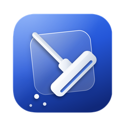

<p align="center"></p>

<h1 align="center">DustBuster</h1>

<p align="center">A privacy-first cleaner and app uninstaller for macOS.</p>

<p align="center">
  <a href="https://github.com/murtaza1905/DustBuster-macOS/actions/workflows/ci.yml"></a>
  <a href="https://github.com/murtaza1905/DustBuster-macOS/releases/latest"></a>
  <a href="LICENSE"></a>
  
  
</p>

Everything runs on your Mac, nothing is sent anywhere, and nothing is ever deleted — items go to the Trash and can be restored from inside the app.

<!-- Screenshots: add images to docs/screenshots/ and reference them here. -->

## What it does

- **System Cleanup** — browser caches (Safari, the Firefox family and every Chromium-based browser it finds, including the per-profile `Cache` / `Code Cache` folders), application caches and user logs in `~/Library`. Apple system-service caches are listed in a separate, collapsed section and left unselected, because macOS simply regenerates them. History, cookies, passwords and bookmarks are never touched.
- **App Uninstaller** — drop a `.app`, review the bundle together with its leftovers, and move the selection to the Trash. Items found by a deterministic signal are preselected; anything that might be shared with another app (vendor folders, shared app groups, name-only matches) is listed under *Check* and left unselected.
- **Large Files** — files of 250 MB or more in Desktop, Documents, Downloads, Movies, Music and Pictures.
- **Running Apps** — quit or force-quit third-party apps.
- **Dashboard** — memory, disk and CPU at a glance.
- **Undo** — the last cleanup and the last 50 trashed items can be restored from the app; uninstalls can be undone per app.
- **Reports and test cases** — every scan can be exported as a plain-text report and as a JSON test case that becomes a permanent regression test (see below).

The interface is currently in Turkish; English localization is on the roadmap.

## Requirements

- macOS 14 Sonoma or later. Universal binary (Apple Silicon and Intel). The UI uses Liquid Glass on macOS 26 and the standard material look on macOS 14 and 15.
- Full Disk Access (System Settings › Privacy & Security › Full Disk Access) — needed to read `~/Library/Caches`, `~/Library/Logs` and app containers.
- To build from source: Xcode 16 or later.

## Install

### Download

1. Get `DustBuster-<version>.dmg` from the [latest release](https://github.com/murtaza1905/DustBuster-macOS/releases/latest) and drag **DustBuster.app** to **Applications**.
2. The app is ad-hoc signed, not notarized. On first launch macOS will refuse to open it; either right-click the app › **Open**, or run:

   ```bash
   xattr -dr com.apple.quarantine /Applications/DustBuster.app
   ```

3. Grant Full Disk Access when asked and switch back to the app.
4. Every release ships `SHA256SUMS.txt`; verify with `shasum -a 256 -c SHA256SUMS.txt --ignore-missing`.

### Build from source

Requires Xcode. No Homebrew needed — the scripts download XcodeGen on their own if it is missing.

```bash
cd ~/Desktop
git clone https://github.com/murtaza1905/DustBuster-macOS.git
cd ~/Desktop/DustBuster-macOS
./scripts/install.sh
```

The script pulls the latest code, generates the Xcode project, builds a universal Release binary, ad-hoc signs it, archives the build to `releases/`, replaces the copy in `/Applications` and launches it. Keep the cloned folder as a permanent hub and run the same command again to update. A failed build never touches the installed app.

```bash
cd ~/Desktop/DustBuster-macOS
./scripts/install.sh                        # update + clean reinstall
./scripts/install.sh --list                 # archived builds in releases/
./scripts/install.sh releases/<file>.zip    # reinstall an archived build
./scripts/build.sh                          # build only → build/DustBuster.app
./scripts/make-dmg.sh                       # build and package → dist/DustBuster-<version>.dmg
./scripts/uninstall.sh                      # remove the app and its preferences
```

To work in Xcode: run `./scripts/install.sh` once (or `xcodegen generate`), then open `DustBuster.xcodeproj`.

## How the uninstaller finds leftovers

Matching lives in a UI-independent Swift package (`Core/`) and runs in five layers:

1. **Deterministic signals read from the bundle itself** — well-known paths derived from the bundle ID; app groups declared in the code-signature entitlements (`Group Containers`, `Application Scripts`); container ownership from containermanagerd metadata (works for UUID-named containers); launchd plists whose program lives inside the bundle; embedded helpers' containers; `pkgutil` receipts (with the system scan on). Preselected.
2. **Homebrew Cask database** — a snapshot of the community-maintained `zap` stanzas from [Homebrew/homebrew-cask](https://github.com/Homebrew/homebrew-cask), embedded in the app and never downloaded at runtime. Suite casks (Office) are resolved to the single-app cask; paths that other casks also own are treated as shared. Refresh with `python3 tools/build-cask-db.py <homebrew-cask checkout>`.
3. **Directory scan** — bundle-ID and whole-word name matching inside `~/Library`, including vendor folders (`Google/Chrome`). Name-only hits are listed under *Check*, unselected.
4. **Per-app conditions** (`Core/Sources/DustBusterCore/Resources/conditions.json`) — explicit `include` / `exclude` globs for apps whose leftovers follow no convention (Xcode's `~/Library/Developer`, Notion's updater cache). Matched by bundle ID or Homebrew token; adding an app is a data change, not a code change.
5. **Safety rules** — other apps from the same vendor, channel variants (Canary/Beta), `com.apple.*` paths for non-Apple apps, vendor-named folders (`Application Support/Microsoft`) and protected user data (Keychains, Mail, Documents…) are never preselected or never listed, whatever layer proposed them. Empty sandbox shells found by a deterministic signal are listed and labelled; empty folders found only by name similarity are dropped.

System Cleanup is driven by data as well (`Core/Sources/DustBusterCore/Resources/rules.json`): scanned roots, forbidden roots, sensitive keywords, the Apple system-service list, vendor folders that are split into their children, and browser definitions.

### Regression tests

Every real-world scan can be exported from the app as a JSON test case (**Test vakası**, *test case*) and dropped into `Core/Tests/DustBusterCoreTests/Fixtures/`; the test suite replays it against a virtual `~/Library` and checks what must be selected, what must be listed unselected and what must never appear. CI runs the suite and builds the app with both Xcode 26 and Xcode 16 on every push.

```bash
cd ~/Desktop/DustBuster-macOS/Core
swift test
```

## Privacy

- No network access. The Homebrew database and all rules are embedded in the app.
- Logs stay on the device (os.log) and are sanitized of usernames, hostnames and home paths; export is manual only.
- Files are moved to the Trash, never deleted directly.

Full policy: [PRIVACY.md](PRIVACY.md).

## Project layout

```
DustBuster/                        # SwiftUI app (views, view models, managers, AboutPanel)
├── Info.plist                     # Bundle metadata (version comes from project.yml)
└── PrivacyInfo.xcprivacy          # Privacy manifest
Core/                              # DustBusterCore Swift package (no UI)
├── Sources/DustBusterCore/        # Scanner, matching rules, cask database, cleanup policy, fixtures
│   └── Resources/                 # cask-zap.json, conditions.json, rules.json
└── Tests/                         # XCTest suite + Fixtures/*.json
tools/                             # build-cask-db.py, make-fixtures.py
scripts/                           # build / install / uninstall / make-dmg (+ common.sh)
.github/workflows/                 # ci.yml (tests + two Xcode builds) · release.yml (tag → DMG + ZIP + checksums)
design/                            # App icon master
docs/                              # README assets
project.yml                        # XcodeGen project definition
```

## Development

- CI on every push and pull request: Core tests plus universal app builds with Xcode 26 (macOS 26 runner) and Xcode 16 (macOS 15 runner) — [CI](https://github.com/murtaza1905/DustBuster-macOS/actions/workflows/ci.yml).
- Releases are produced by the [Release workflow](.github/workflows/release.yml) from a `v*` tag; see [CONTRIBUTING.md](CONTRIBUTING.md) for the exact steps.
- Changes are tracked in [CHANGELOG.md](CHANGELOG.md).

## Contributing and support

- Bugs and feature ideas: [Issues](https://github.com/murtaza1905/DustBuster-macOS/issues) (templates are provided). For wrong matches or misses in the uninstaller, attach the exported `.txt` report or JSON test case — that is what turns a report into a permanent fix.
- Pull requests are welcome — see [CONTRIBUTING.md](CONTRIBUTING.md).
- Security problems: see [SECURITY.md](SECURITY.md) — please do not open a public issue.

## License

DustBuster is released under the [MIT License](LICENSE). The embedded leftover database is derived from Homebrew Cask (BSD-2-Clause); see [THIRD_PARTY_NOTICES.md](THIRD_PARTY_NOTICES.md).

## Author

Murat Onurcu — [muratonurcu@outlook.com](mailto:muratonurcu@outlook.com)
